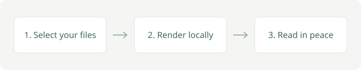

# Terminal Markdown Sample

日本語とASCII、結合文字 é、絵文字 😀 を含むサンプルです。

**Bold text**, _italic text_, ~~removed text~~, and **nested _emphasis_**.
Inline code: `const message = "Hello"`.

[First link](./getting-started.md) and [Second link](./architecture.md) share one line.

## Lists and quotes

- First item
  - Nested item with **bold text**
  - [x] Completed task
  - [ ] Pending task

3. Third item
4. Fourth item

> A quote with [a link](./markdown-reference.md).
>
> > A nested quote containing 日本語。

## Code blocks

```typescript
const greeting: string = 'Hello, 日本語';
console.log(greeting);
```

```unknown-language
Unknown language stays readable.
```

## Simple table and image

| Name   | Description                             |
| ------ | --------------------------------------- |
| Reader | Local Markdown viewer                   |
| Guide  | [Getting started](./getting-started.md) |



## Safe text

<div>HTML is displayed as text in the terminal.</div>

Long text wraps within the preview: abcdefghijklmnopqrstuvwxyzABCDEFGHIJKLMNOPQRSTUVWXYZ0123456789abcdefghijklmnopqrstuvwxyzABCDEFGHIJKLMNOPQRSTUVWXYZ0123456789.

## Final heading

Tab stops at the final navigation target. Enter opens a selected local document link.

## Table alignment and wrapping

| Left                                           |            Center             | Right |
| :--------------------------------------------- | :---------------------------: | ----: |
| 日本語の長い説明文がセルの中で折り返されます。 |             中央              | 12345 |
| **Bold** and `code`                            |             😀 é              |     7 |
| Empty neighbor                                 |                               |     0 |
| Escaped pipe: a\|b                             | [Guide](./getting-started.md) |    42 |

## Wide table

Use Left / Right in the preview to inspect the first and last columns. Tab also reveals a hidden link.

| First | Second | Third    | Fourth | Fifth | Sixth      | Seventh | Eighth                          |
| ----- | ------ | -------- | ------ | ----- | ---------- | ------- | ------------------------------- |
| START | 日本語 | **Bold** | Center | 12345 | Empty next |         | [LAST](./markdown-reference.md) |

## Navigation practice

Search for 日本語 with `/`, use `g` / `G`, or press `o` to choose a heading.
Select [a local document](./getting-started.md) or [the anchor below](#navigation-target) with Tab and press Enter. Use `<` / `>` to go back and forward.

### Navigation target

Editing this file while it is open refreshes the preview. Positions are kept for this session.

## Image navigation

Use Tab / Shift+Tab to select an image and Enter to request its default application.

[](./getting-started.md)


| Description | Image                                         |
| ----------- | --------------------------------------------- |
| Table image |  |
